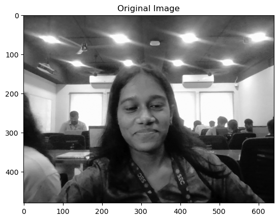
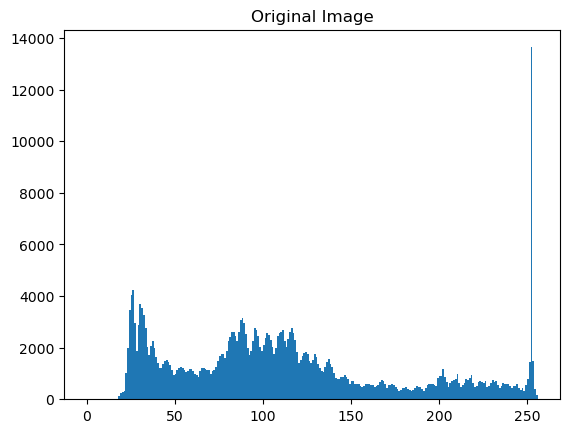
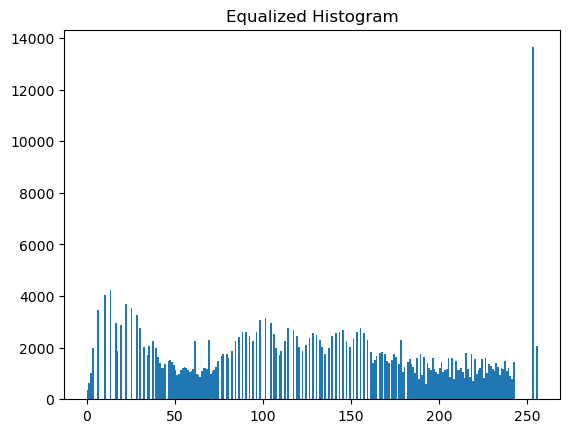
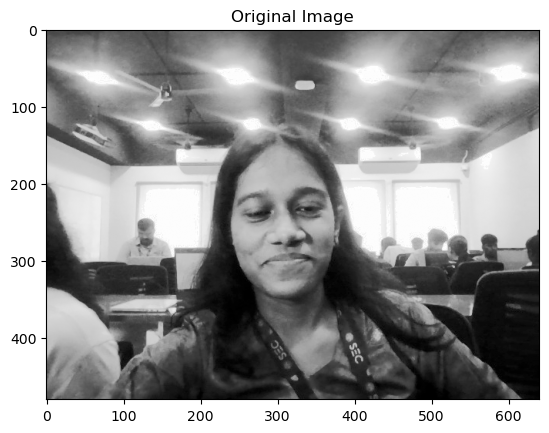
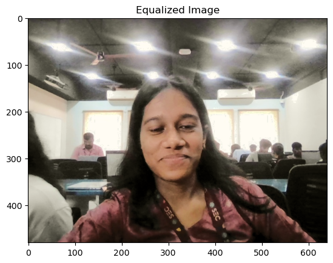
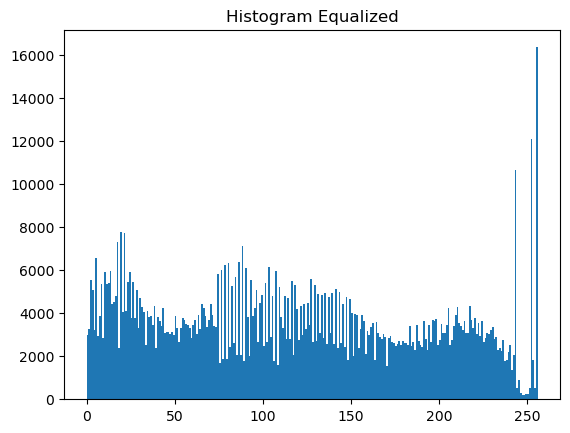
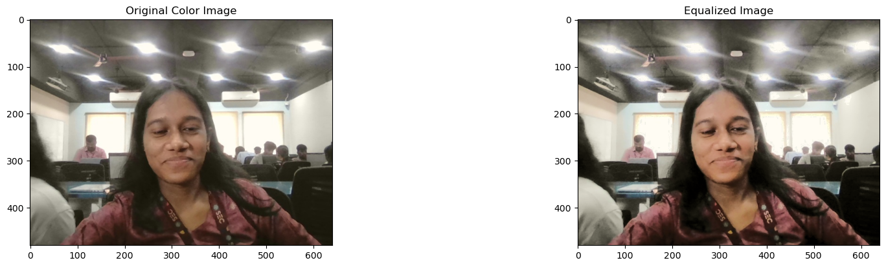
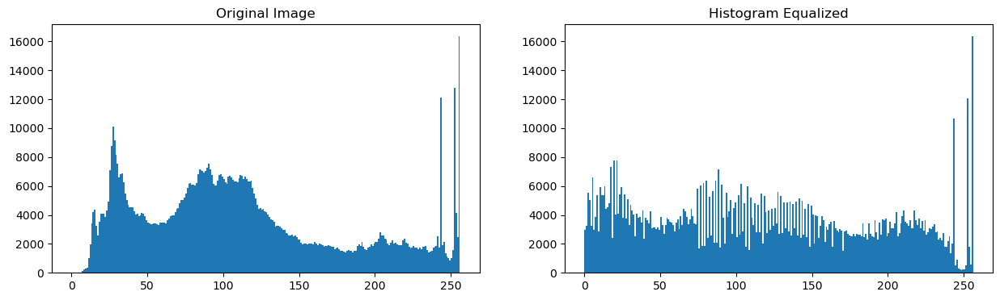

### Ex. No: 03  
### Histogram of an Images 

### Name: KRITHIKA V    Reg. No: 212225040194


## Import Python necessary libraries


```python
import cv2
import numpy as np
import matplotlib.pyplot as plt
```

## Histogram Equalization for Grayscale Images


```python
img = cv2.imread('my_image.jpg', cv2.IMREAD_GRAYSCALE)
```


```python
plt.imshow(img, cmap='gray')
plt.title('Original Image')
plt.show()

```


    

    


```python
plt.hist(img.ravel(),256,range = [0, 256]);
plt.title('Original Image')
plt.show()
```


    

    


```python
img_eq = cv2.equalizeHist(img)
```


```python
plt.hist(img_eq.ravel(), 256, range = [0, 256])
plt.title('Equalized Histogram')
```


    Text(0.5, 1.0, 'Equalized Histogram')


    

    


```python
plt.imshow(img_eq, cmap='gray')
plt.title('Original Image')
plt.show()
```


    

    


## Histogram Equalization for Color Images


```python
img = cv2.imread('my_image.jpg', cv2.IMREAD_COLOR)
```


```python
img_hsv = cv2.cvtColor(img, cv2.COLOR_BGR2HSV)
```


```python
img_hsv[:,:,2] = cv2.equalizeHist(img_hsv[:, :, 2])
```


```python
img_eq = cv2.cvtColor(img_hsv, cv2.COLOR_HSV2BGR)
```


```python
 plt.imshow(img_eq[:,:,::-1]); plt.title('Equalized Image');plt.show()
```


    

    


```python
plt.hist(img_eq.ravel(),256,range = [0, 256]); plt.title('Histogram Equalized');plt.show()
```


    

    


```python
plt.figure(figsize = (20,10))
plt.subplot(221); plt.imshow(img[:, :, ::-1]); plt.title('Original Color Image')
plt.subplot(222); plt.imshow(img_eq[:, :, ::-1]); plt.title('Equalized Image')
plt.show()
```


    

    


```python
plt.figure(figsize = [15,4])
plt.subplot(121); plt.hist(img.ravel(),256,range = [0, 256]); plt.title('Original Image')
plt.subplot(122); plt.hist(img_eq.ravel(),256,range = [0, 256]); plt.title('Histogram Equalized')
```


    Text(0.5, 1.0, 'Histogram Equalized')


    

    

