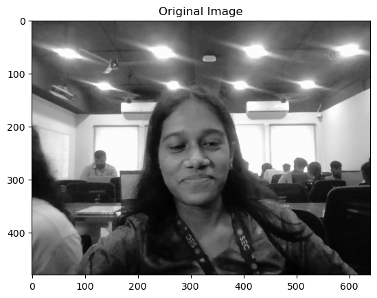
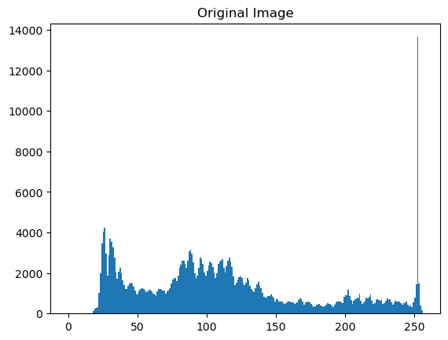
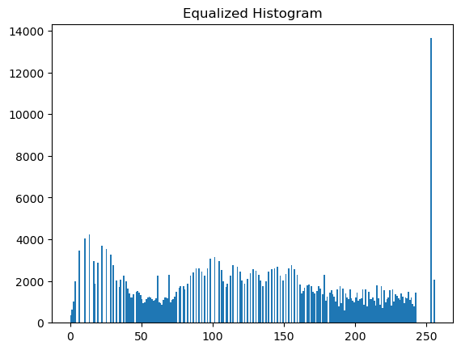
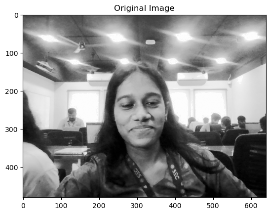
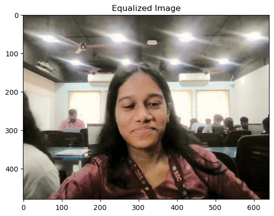
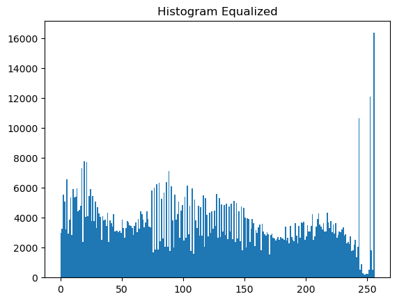
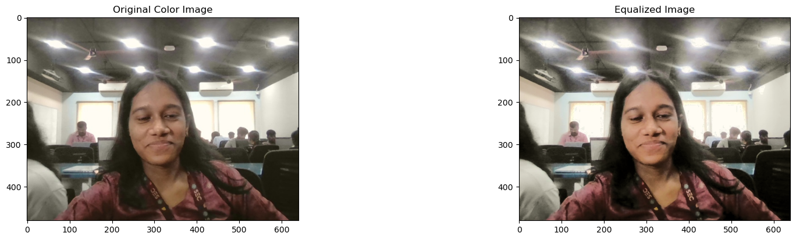
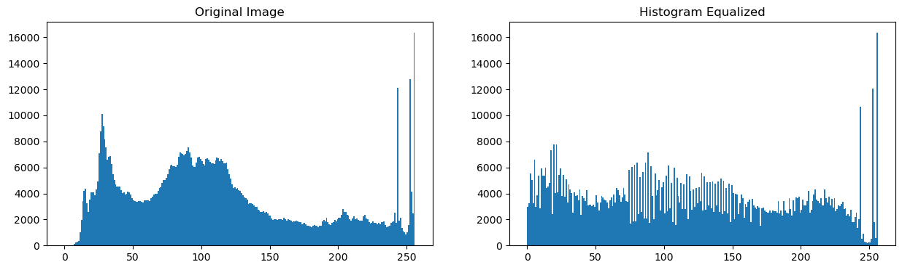

# Histogram Equalization Using OpenCV (Grayscale & Color Images)

---

## Aim

To write a Python program using OpenCV to perform histogram equalization on both grayscale and color images to enhance image contrast and brightness.

The program performs the following operations:

- Read and display a grayscale image  
- Plot histogram of the grayscale image  
- Apply histogram equalization on grayscale image  
- Read and display a color image  
- Plot histogram of B, G, R channels  
- Convert image to HSV color space  
- Apply histogram equalization on the Value (V) channel  
- Convert the enhanced image back to BGR format  
- Display original and enhanced images with histograms  

---

## Software Used

- Anaconda – Python 3.7  
- Jupyter Notebook / VS Code  
- OpenCV (`cv2`)  
- NumPy  
- Matplotlib  

---

## Algorithm

### Step 1:
Import the required libraries: OpenCV, NumPy, and Matplotlib.

### Step 2:
Read the image `parrot.jpg` in grayscale format.

### Step 3:
Display the grayscale image and plot its histogram.

### Step 4:
Apply histogram equalization using `cv2.equalizeHist()` to enhance contrast.

### Step 5:
Display original grayscale image, its histogram, enhanced image, and its histogram using a 2 × 2 grid.

### Step 6:
Read the same image in color format.

### Step 7:
Split the image into B, G, R channels and plot their histograms.

### Step 8:
Convert the image from BGR to HSV color space.

### Step 9:
Apply histogram equalization on the V (Value) channel.

### Step 10:
Merge the channels and convert the image back to BGR format.

### Step 11:
Display original color image, histogram, enhanced image, and enhanced histogram using a 2 × 2 grid.

---

## Program

### Developed By:
**Name:** Krithika V 

### Register No:
212225040194 

```
import cv2
import numpy as np
import matplotlib.pyplot as plt

img = cv2.imread('my_image.jpg', cv2.IMREAD_GRAYSCALE)

plt.imshow(img, cmap='gray')
plt.title('Original Image')
plt.show()

plt.hist(img.ravel(),256,range = [0, 256]);
plt.title('Original Image')
plt.show()

img_eq = cv2.equalizeHist(img)

plt.hist(img_eq.ravel(), 256, range = [0, 256])
plt.title('Equalized Histogram')

plt.imshow(img_eq, cmap='gray')
plt.title('Original Image')
plt.show()

img = cv2.imread('my_image.jpg', cv2.IMREAD_COLOR)

img_hsv = cv2.cvtColor(img, cv2.COLOR_BGR2HSV)

img_hsv[:,:,2] = cv2.equalizeHist(img_hsv[:, :, 2])

img_eq = cv2.cvtColor(img_hsv, cv2.COLOR_HSV2BGR)

plt.imshow(img_eq[:,:,::-1]); plt.title('Equalized Image');plt.show()

plt.hist(img_eq.ravel(),256,range = [0, 256]); plt.title('Histogram Equalized');plt.show()

plt.figure(figsize = (20,10))
plt.subplot(221); plt.imshow(img[:, :, ::-1]); plt.title('Original Color Image')
plt.subplot(222); plt.imshow(img_eq[:, :, ::-1]); plt.title('Equalized Image')
plt.show()

plt.figure(figsize = [15,4])
plt.subplot(121); plt.hist(img.ravel(),256,range = [0, 256]); plt.title('Original Image')
plt.subplot(122); plt.hist(img_eq.ravel(),256,range = [0, 256]); plt.title('Histogram Equalized')

```
---

##  Output

### Input Grayscale image



### Input Grayscale image range



### Input Grayscale image equalized histogram



### Histogram of Grayscale images and Color image channels
### Original image



### Equalized image



### Equalized histogram



### Final output of original image and equalized



###  Final output of original image and its histogram equalized



---

## Result

Thus, histogram equalization is successfully performed on both grayscale and color images using OpenCV. The contrast and brightness of the images are significantly improved, enhancing visual quality and feature visibility.
